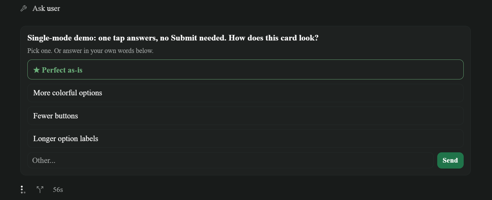
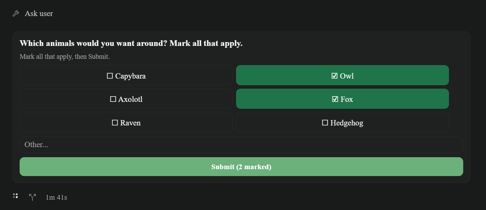

# paseo-plugin-ask

`paseo-plugin-ask` is a questions widget for [Paseo](https://paseo.sh) agents, shipped as two parts in one repository: a Paseo daemon plugin at the root and a [pi](https://github.com/earendil-works/pi) extension in `extension/`. It gives an agent an `ask_user` tool that renders a tappable card with 2 to 6 options in the Paseo timeline on desktop and mobile.

Vibecoded: an AI agent wrote and debugged this end to end, directed by me.

## How `ask_user` works

The model calls `ask_user` with one short question and 2 to 6 options. The call blocks until the human answers or the timeout passes (default 24 hours, max 7 days), then returns the answer as the tool result. On timeout, the tool result tells the model to proceed with its best judgment. Typing a message in the composer instead of tapping the card closes the question and tells the model to read the message.

## Question modes

Every card includes an `Other` free-text field. One option may set `recommended: true`; it renders green as the agent's recommendation and never preselects.

| Mode | UI | Behavior |
| --- | --- | --- |
| `single` | Immediate buttons | One tap submits the answer. |
| `multi` | Checkboxes and a `Submit` button | Pick any number of options, then submit. |
| `multi` with `leadPick` | Checkboxes, a star per option, and `Submit` | Marks one lead choice. Starring an option includes it. |


Compact option sets flow into a two-column grid; the Submit button uses the success color:



## Architecture

The two parts communicate through one JSON file per agent at `~/.pi/agent/ask-spool/<agentId>.json`.

- The pi extension (`extension/`) runs inside the pi process. It exposes `ask_user`, writes the open question to the spool file, and polls that file for the answer.
- The daemon plugin (repo root) watches `~/.pi/agent/ask-spool/`, renders each open question as a timeline row, and writes the human's answer back to the same file.

Plugin code changes do not require a daemon restart. Reload in place with `paseo plugin reload paseo-plugin-ask`.

## What happens to a question

Timeline rows are per question: a new question appends a fresh card, and an answer flips the existing card in place. Every question ends in one of five terminal states:

- `answered`: answered by the human. Submitting with nothing picked and no text is a valid empty answer, never a cancel.
- `superseded`: replaced by a newer question from the same agent, which always wins. A question left open by a crashed process never blocks the next one.
- `timed out`: reached its timeout before an answer arrived.
- `overtaken`: the human typed a new message instead of answering; the pending question closes and the agent is told to act on the message.
- `cancelled`: the turn was aborted.
- `expired`: 8 days passed with no asking process left.

## Installation

Requires Paseo >= 0.8.0 and pi with extension support. Both parts must be installed.

### 1. Paseo daemon plugin

```sh
git clone https://github.com/bitbutter/paseo-plugin-ask.git
cd paseo-plugin-ask
npm install
```

Register the plugin in `~/.paseo/config.json` inside the `"plugins"` object:

```json
"paseo-plugin-ask": { "source": "directory", "path": "/absolute/path/to/paseo-plugin-ask", "enabled": true }
```

Restart Paseo, or run `paseo plugin reload paseo-plugin-ask`.

### 2. Install the pi extension

Copy `extension/` to `~/.pi/agent/extensions/ask-user/`, or run the helper script:

```sh
scripts/install-extension.sh
```

New pi sessions pick up the extension automatically. Reload any running agent to apply it to an existing session.

After installing both parts, type `/ask-test` in any agent's composer to append a demo card without a model turn. It accepts `single` (default), `multi`, or `lead`.

## Known limitations

Plugin timeline rows are live-only in the current Paseo app. A refetch can hide an open card until it is re-appended; open questions re-surface on that agent's next turn and every 5 minutes.

After a daemon restart or plugin reload, the spool watcher does not start until an agent fires a session or turn event. Avoid rapid consecutive plugin reloads: reload once, between turns, or event delivery to the watcher can lag until the next turn boundary.

A question ended by a cancel or a supersede can leave its card looking open. Tapping it reports the question is no longer open.

## License

Released under the Zero-Clause BSD license (0BSD).
